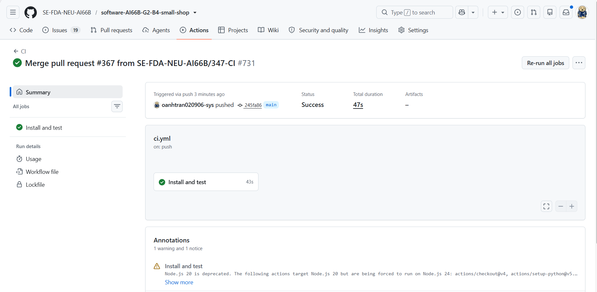
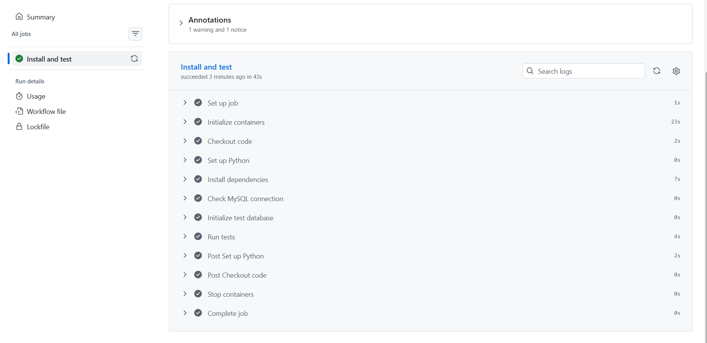

# Milestone 5 - Operation Guie
## 1. How to run and release
### 1.1 The URL and platform
[Public frontend URL](https://yums-frontend-qjq2.onrender.com)    
[Public backend URL](https://small-shop-tailscale.onrender.com)    
[Health check link](https://small-shop-tailscale.onrender.com/health)    
(The frontend communicates with the backend via its public Render link, while the backend connects to MySQL database.)    
Hosting platform: Render and Tailscale    
Source repository: GitHub's software-AI66B-G2-B4-small-shop's. Main branch.
[Repository link](https://github.com/SE-FDA-NEU-AI66B/software-AI66B-G2-B4-small-shop)    

### 1.2. How a new version gets there
This is how a new version gets updated to the public web:
1. Us developers create a side branch and work there.
2. After finishing what to do, we commit then push the branch to GitHub, then create a Pull Request.
3. We wait until the automated tests and CI checks are all passed (green), and another person to manually approve it.
4. Another one of us (not the one who worked in that PR) go try and approve the PR if it's valid. Then we merge this into main branch.
5. On Render, i already set both the services's Auto-deploy mode at 'On commit'. With the source branch as the main branch, this means whenever there's something merged into main branch, it will be auto deployed on Render thus available on the public web version.
6. We really go to the public web to test if the newest functions are there.    

We only count a new version as successful once both the deployment of Render and the manual trial done by us on the public web works correctly.

### 1.3. How to go back to the latest good version if something breaks
There are two ways we can do this:
- Via Render's rollback option:
1. Go to Render's dashboard and find the affected service (back or frontend).
2. Trace back the deploy history carefully, there's a history of what deployed.
3. Find the latest good version there (might be found using the same commit code as on GitHub).
4. Choose "Rollback" and confirm. Wait till it's complete.
5. Manually try to verify that the latest good version is brought back.
- Via GitHub's reverse/rollback option:
1. Run this command: git revert <commit-code> and push. Or open GitHub Desktop and check the History tab when being at that repository.
2. Wait for CI green, and wait for approval + merged if needed.
3. Go to Render's dashboard to see if that rollback comit is deployed (if not, it still can be deployed manually).
4. Manually try to verify that the latest good version is brought back.    

Note: This only can be done when we remember the exact commit code of the latest good version, and after all of us have discussed thoroughly on what's the problem and really agree to rollback, as well as notifying again once the rollback is finished to take turns to test manually.

## 2. The CI Pipeline

### 2.1. Overview

The project uses GitHub Actions to automatically verify code changes before they are merged into the `main` branch.

The CI workflow is defined in `.github/workflows/ci.yml`.

The workflow performs the following tasks:
- Checks out the source code.
- Sets up the Python environment.
- Installs project dependencies.
- Checks the MySQL database connection.
- Initializes the test database.
- Runs automated tests using pytest.

The workflow is triggered by the GitHub events configured in `ci.yml`.

### 2.2. CI Workflow Steps

**1. Checkout code**

Uses `actions/checkout@v4` to download the repository source code into the GitHub Actions runner so that subsequent steps can access the project files.

**2. Set up Python**

Uses `actions/setup-python@v5` to configure Python 3.12. It also enables pip dependency caching to reduce installation time in subsequent workflow runs.

**3. Install dependencies**

Upgrades pip and installs the required Python packages from `backend/requirements.txt`.

**4. Check MySQL connection**

Connects to the MySQL test database using the environment variables configured in the workflow. This verifies that the database service is accessible before running the tests.

**5. Initialize test database**

Runs `python -m backend.database.init_db` to initialize the test database and prepare the database schema required by the application.

**6. Run tests**

Runs `python -m pytest tests/ -v` to execute the project's automated test suite and display detailed test results.

### 2.3. CI Execution Evidence

The following information records the actual result of the latest successful CI execution on the `main` branch.

**Latest successful GitHub Actions run:**

### 2.4. Branch Protection Rules

The `main` branch is protected by GitHub branch protection rules to ensure that code changes are reviewed and verified before merging.

The following requirements are enabled:

1. **Require a pull request before merging:** Direct changes must go through a Pull Request.
2. **Require at least 1 approving review:** At least one reviewer must approve the Pull Request before it can be merged.
3. **Require status checks to pass before merging:** The required CI status check must pass before merging is allowed.

These rules help prevent unreviewed or failing code from being merged into the `main` branch.
