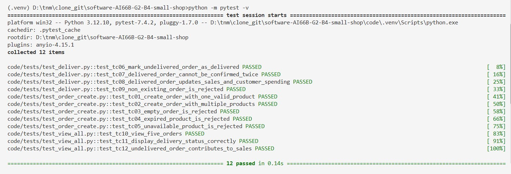

# Milestone 4 - Software Testing
## 1. What we test, and why
| Layer | Test | Why |
|-------|------|-----|
|  layer01 | test01 | reason01 |
|  layer02 | test02 | reason02 |

**Risk:**    
2-3 setences about risks go here...

## 2. Test cases for every P0 story
### 2.1. US01: Order creation
| ID | Story | Input | Expected | Kind |
|----|-------|-------|----------|------|
| TC-01 | US01: Create an order | One valid product, quantity = 1 (Latte x1) | 201 Order created successfully | Normal |
| TC-02 | US01: Create an order | Several valid products, random quantity (Latte x1, Tiramisu x2, Americano x3) | 201 Order created successfully | Normal |
| TC-03 | US01: Create an order | Nothing (empty order) | 422 An order must contain at least one product! (BR10) | Error |
| TC-04 | US01: Create an order | At least one expired order (expiry_date >= NOW) | 409 This product is expired and cannot be sold! (BR4) | Error |
| TC-05 | US01: Create an order | At least one unavailable product (status = Unavailable) | 409 This product is insufficient at the moment! (BR1) | Error |

### 2.2. US02: Order delivery status
| ID | Story | Input | Expected | Kind |
|----|-------|-------|----------|------|
| TC-06 | US02: Order delivery status | An undelivered order | 200 Order delivered successfully! | Normal |
| TC-07 | US02: Order delivery status | An already delivered order | 409 You already confirmed this order’s delivery status! (BR2) | Error |
| TC-08 | US02: Order delivery status | An order that is initially undelivered and worths 100k VND | 200 Order delivered successfully!; Total sales +100k VND, customer{id}’s total spend + 100k VND (BR2) | Normal |
| TC-09 | US02: Order delivery status | A non-existing order ID | 404 Order not found. | Error |

### 2.3. US06: View all orders
| ID | Story | Input | Expected | Kind |
|----|-------|-------|----------|------|
| TC-10 | US06 View all orders | 5 valid orders | 200 Orders loaded successfully!
 | Normal |
| TC-11 | US06 View all orders | Multiple orders which include both Delivered and Not delivered | 200 Orders loaded successfully! (Each order’s delivery status must display correctly) | Normal |
| TC-12 | US06 View all orders | An order that is undelivered but somehow still contributes to sales (means violating BR2) | 409 Conflict - Order violated completion rules! | Error |

*continue with your next US...*

## 3. Automated tests
Test results for US01:

*please make the tests in tests/, add instructions to run the tests in docs/SETUP.md, then come back here to attach images of the tests' results.*

## 4. What the tests found
### 4.0. No bug found
- The rule we broke on purpose:
- The red output:
*@aizun pls reformat this for me*
How to break each Errror test to show red output: Come to backend/services/test_order.py and change:
- TC-03: line 9: *if len(products) == 0:* into *if len(products) < 0:*
- TC04: line 17: *if product["name"] in repo.expired_products:* into *if False:*
- TC-05: line 23: *if product["name"] in repo.unavailable_products:* into *if False:*
- TC-07: line 42: *if order["deliver_status"] == "delivered":* into *if False:*
- TC-12: line 63: *if (order["deliver_status"] == "not_deliver" and order["included_in_sales"] is True):* into *if False:*

### 4.1. Entry 1
A bug we found no.1:
- The issue:
- The fix:
- The test now guarding it:
### 4.2. Entry 2
A bug we found no.2:
- The issue:
- The fix:
- The test now guarding it:

*continue with more bugs if any...*