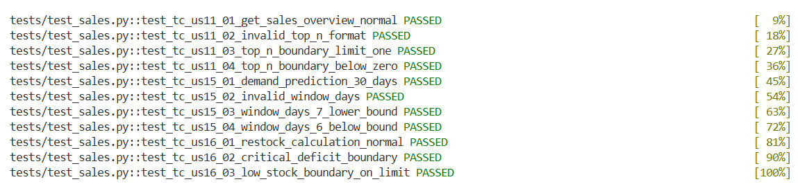
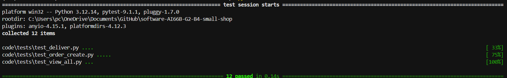

# Milestone 4 - Software Testing
## 1. What we test, and why
| Layer | Test | Why |
|-------|------|-----|
| `code/tests/test_order_create.py` and `code/backend/services/test_order.py` (order creation) | Pytest unit tests using a fake product repository | Covers successful creation with one or multiple products, and rejects empty orders, expired products, and unavailable products. These checks protect order validity without requiring a live database. |
| `code/tests/test_deliver.py` and `code/backend/services/test_order.py` (delivery confirmation) | Pytest unit tests using a fake order repository | Covers successful delivery confirmation, prevents confirming an already delivered order, verifies sales and customer-spending amounts, and handles missing orders. Delivery affects order status and financial totals, so errors could cause incorrect records or duplicate processing. |
| `code/tests/test_view_all.py` and `code/backend/services/test_order.py` (viewing orders) | Pytest unit tests using a fake orders repository | Verifies that orders load with their delivery statuses and rejects an undelivered order that is incorrectly included in sales. This guards order reporting and completion rules. |
| `code/tests/test_auth.py` and `code/backend/services/auth.py` (authentication) | Pytest unit tests with a fake DB cursor and connection | Checks exact username matching, bcrypt password verification and hashing, rejection of wrong credentials or inactive users, and database connection cleanup. Authentication errors could allow unauthorized access or block valid users. |
| `code/tests/test_sales.py` (sales analytics, demand forecasting, and restock recommendations) | API tests using FastAPI's `TestClient` | Exercises the sales overview and predictions endpoints. It checks category and top-N results, invalid and boundary parameters, forecasting windows, and that restock quantities and stock-status badges are returned as expected. These tests cover the API behavior for US11, US15, and US16. |
| `code/backend/database/*.sql` (schema and constraints) | No automated schema or database integration tests yet | The database schema is critical to data integrity, but the current automated tests do not directly verify schema constraints against a database. |
| `code/frontend/html` and `code/frontend/js` (user interface) | No automated browser tests | UI behavior is checked manually in the browser. The current automated suite focuses on backend services and API behavior rather than browser interactions. |

**Risk:**
The highest risks covered by the current automated tests are order validation, delivery status and its financial effects, order-list completion rules, authentication, and sales/forecasting/restock API behavior. Failures in these areas could allow invalid orders, incorrectly update sales, misreport order status, permit unauthorized access, or provide incorrect analytics and stock recommendations. The unit tests use fakes for order and authentication behavior; database schema constraints and browser behavior remain outside automated coverage.

## 2. Test cases for every P0 story
### 2.1. US01: Order creation
| ID | Story | Input | Expected | Kind |
|----|-------|-------|----------|------|
| TC-01 | US01: Create an order | One valid product, quantity = 1 (Latte x1) | 201 Order created successfully | Normal |
| TC-02 | US01: Create an order | Several valid products, random quantity (Latte x1, Tiramisu x2, Americano x3) | 201 Order created successfully | Normal |
| TC-03 | US01: Create an order | Nothing (empty order) | 422 An order must contain at least one product! (BR10) | Error |
| TC-04 | US01: Create an order | At least one expired order (expiry_date >= NOW) | 409 This product is expired and cannot be sold! (BR4) | Error |
| TC-05 | US01: Create an order | At least one unavailable product (status = Unavailable) | 409 This product is insufficient at the moment! (BR1) | Error |

### 2.2. US02: Order delivery status
| ID | Story | Input | Expected | Kind |
|----|-------|-------|----------|------|
| TC-06 | US02: Order delivery status | An undelivered order | 200 Order delivered successfully! | Normal |
| TC-07 | US02: Order delivery status | An already delivered order | 409 You already confirmed this order’s delivery status! (BR2) | Error |
| TC-08 | US02: Order delivery status | An order that is initially undelivered and worths 100k VND | 200 Order delivered successfully!; Total sales +100k VND, customer{id}’s total spend + 100k VND (BR2) | Normal |
| TC-09 | US02: Order delivery status | A non-existing order ID | 404 Order not found. | Error |

### 2.3. US06: View all orders
| ID | Story | Input | Expected | Kind |
|----|-------|-------|----------|------|
| TC-10 | US06 View all orders | 5 valid orders | 200 Orders loaded successfully!
 | Normal |
| TC-11 | US06 View all orders | Multiple orders which include both Delivered and Not delivered | 200 Orders loaded successfully! (Each order’s delivery status must display correctly) | Normal |
| TC-12 | US06 View all orders | An order that is undelivered but somehow still contributes to sales (means violating BR2) | 409 Conflict - Order violated completion rules! | Error |

### 2.4. US11: Sales analytics
| ID | Story | Input | Expected | Kind |
|----|-------|-------|----------|------|
| TC-13 | US11 View top selling products | top_n="5", category="Beverage" | 200 OK, returns up to 5 top-selling Beverage items sorted by revenue | Normal |
| TC-14 | US11 View top selling products | top_n="invalid_text" | 500 Internal Server Error (or 422/400), handles invalid parameter type | Error |
| TC-15 | US11 View top selling products | top_n="1" | 200 OK, returns exactly 1 top-selling item | Boundary, on limit |
| TC-16 | US11 View top selling products | top_n="0" | 200 OK with empty list [] | Boundary, just below |

### 2.5. US15: Demand forecasting
| ID | Story | Input | Expected | Kind |
|----|-------|-------|----------|------|
| TC-17 | US15 Demand forecasting | window_days=30 | 200 OK, returns demand predictions based on historical sales rate | Normal |
| TC-18 | US15 Demand forecasting | window_days=45 | 200 OK (or 400 Bad Request if custom range validation is active) | Edge case / Error |
| TC-19 | US15 Demand forecasting | window_days=7 | 200 OK, calculates demand for 7 days window | Boundary, on limit |
| TC-20 | US15 Demand forecasting | window_days=6 | 200 OK (or 400 Bad Request) | Edge case, low window |

### 2.6. US16: Restock recommendation
| ID | Story | Input | Expected | Kind |
|----|-------|-------|----------|------|
| TC-21 | US16 Restock recommendation | current_stock=15, predicted_demand=10 | 200 OK, suggested_restock calculated, status_badge="Sufficient Stock" | Normal |
| TC-22 | US16 Restock recommendation | current_stock=4 | 200 OK, current_stock <= 5 triggers status_badge="Critical Deficit" | Boundary, below limit |
| TC-23 | US16 Restock recommendation | current_stock=5 | 200 OK, stock at critical threshold triggers "Critical Deficit" | Boundary, on limit |
| TC-24 | US16 Restock recommendation | current_stock=10 (with high demand) | 200 OK, triggers status_badge="Restock Needed" | Normal / Boundary |
---

## 3. Automated tests
Test results for US01:

*please make the tests in tests/, add instructions to run the tests in docs/SETUP.md, then come back here to attach images of the tests' results.*

Test results for Sales & Forecasting (US11, US15, US16):


## 4. What the tests found
### 4.0. No bug found
- The rule we broke on purpose:
- The red output:
How to break each Errror test to show red output: Come to backend/services/test_order.py and change:
- TC-03: line 9: 
```if len(products) == 0:``` into ```if len(products) < 0:```
- TC04: line 17: ```if product["name"] in repo.expired_products:``` into ```if False:```
- TC-05: line 23: ```if product["name"] in repo.unavailable_products:``` into ```if False:```
- TC-07: line 42: ```if order["deliver_status"] == "delivered":``` into ```if False:```
- TC-12: line 63: ```if (order["deliver_status"] == "not_deliver" and order["included_in_sales"] is True):``` into ```if False:```

### 4.1. Entry 1
A bug we found no.1: business-rule validation failures
- The issue: The application failed to raise OrderError for several invalid scenarios, including duplicate delivery confirmation, empty orders, expired products, unavailable products, and incorrect sales calculation for undelivered orders
- The fix:Fixed in PR #245 by implementing the required validation logic and error handling.
- The test now guarding it:The tests remain as regression tests and now pass successfully (12 passed).

The test were failed:


After fixing, test case was success:


*continue with more bugs if any...*

