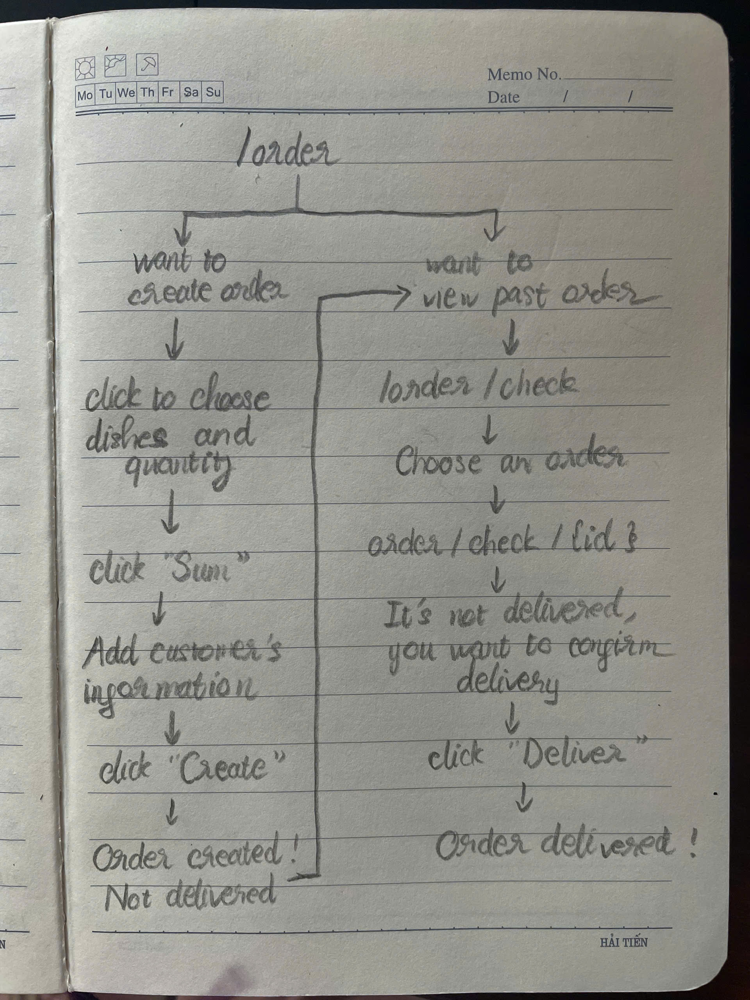
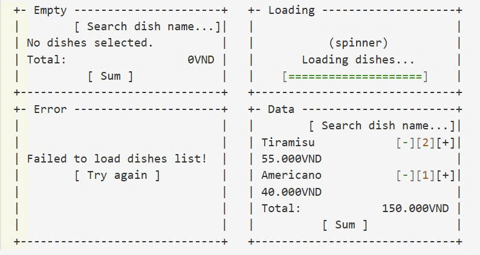
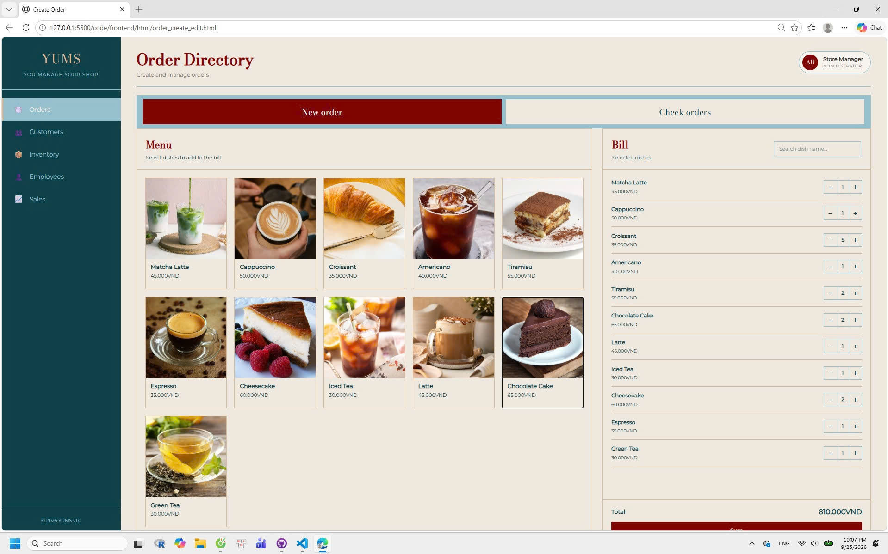
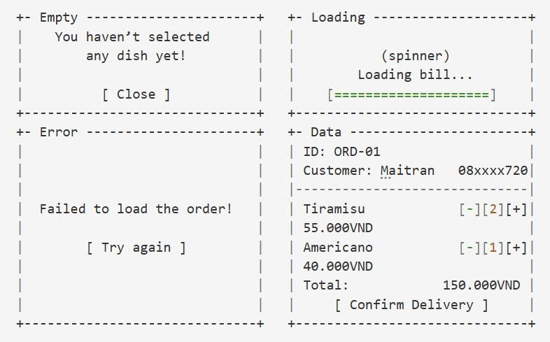
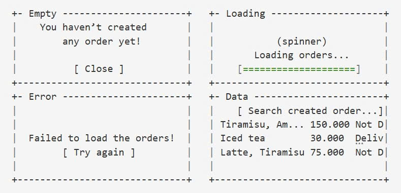
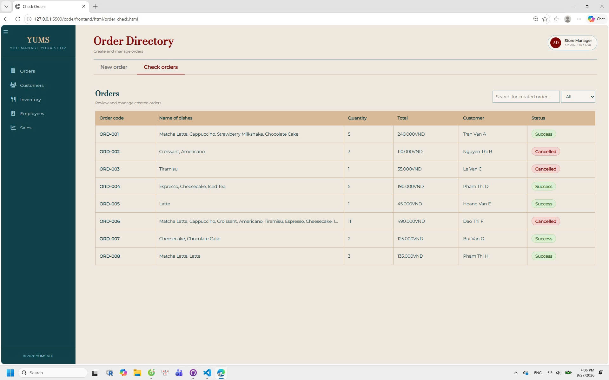

# YUMS — UI Documentation (M3)

## 1. PO Stories and Screen Flow

### 1.1 PO Stories

| User Story | Screen | Route | Status | Related Issue |
|---|---|---|---|---|
| US01 - Create an order | Order Directory (New order tab) | `/order` | partly works - it’s fine by our old logic in linking a to-be-created order to a customer, but not by our new logic of this problem. Will fix this once the code is fixed. | #198 |
| US02 — Confirm delivery status | Order Directory (Check order tab) | `/order/check/{id}/deliver` | partly works - we’ve agreed that an order should have multiple delivery status rather than multiple payment status, but it’s still working by payment status, where Success = successful in payment + delivered | #199 |
| US06 - View all orders | Order Directory (Check order tab) | `/order/check` | works | #203 |

**Status:** Not Started / In Progress / Completed

### 1.2 Screen Flow Diagram

<!-- Add or update the screen-flow diagram here. -->

---

## 2. UI Wireframes

Document every screen related to the PO user stories.

### 2.1 [Create an Order]

**Related User Story:** US01 — [Create an order]

**Purpose:**  
The user comes here to create a new order by choosing dishes and quantity, sum them up and confirm the customer’s payment.

**Route:**  
`/order`

**API Endpoints:**

| Method | Endpoint | Purpose |
|---|---|---|
| GET | `/api/products` | Fetch products to display on the selection area |
| GET | `/api/customers/search?phone=<number>` | Fetch the customer(s) with the phone number the order creator is trying to search |
| POST | `api/orders` | Create new order |

**Wireframe:**

### 2.2 [Confirm Delivery Status]

**Related User Story:** US02 — [Confirm an order's delivery status]

**Purpose:**  
The user comes here to confirm an already-created order’s delivery status by changing it from Not delivered to Delivered.

**Route:**  
`/order/check/{id}/deliver`

**API Endpoints:**

| Method | Endpoint | Purpose |
|---|---|---|
| POST | `api/orders/{id}` | Fetch the order with that particular id's information |
| PATCH | `/order/check/{id}/deliver` | Change that order's delivery status

**Wireframe:**

### 2.3 [View All Orders]

**Related User Story:** US01 — [View all orders]

**Purpose:**  
The user comes here to view previously created orders and their basic information.

**Route:**  
`/order/check`

**API Endpoints:**

| Method | Endpoint | Purpose |
|---|---|---|
| GET | `api/orders` | Fetch all orders |

**Wireframe:**

---

## 3. User-Friendly Error Messages

Document at least four error messages mapped to actual API error codes and business rules.

| # | Related User Story | API Error Code | Business Rule | User-Friendly Message | Suggested Action |
|---|---|---|---|---|---|
| 1 | US01 | 409 | BR1 | This product is insufficient at the moment! | Choose another product that is not ran out |
| 2 | US01 | 409 | BR4 | This product is expired and cannot be sold! | Choose another product that is still edible |
| 3 | US01 | 422 | BR10 | An order must contain at least one product! | Make sure to click at least one dish before clicking "Sum" |
| 4 | US02 | 409 | BR2 | Your already confirmed this order's delivery status! | Only change a Not Delivered order's delivery status. Or "Deliver" button won't appear on already-delivered orders at all |

**Notes:**
- Use error codes that actually exist in the API/backend.
- Link each error to the relevant business rule.
- Write messages in language that users can understand.
- Explain what the user can do next.
- Do not invent error codes or business rules.

---

## 4. Changes Since M2

Describe the UI changes made since Milestone 2 and explain why they were needed.

### Change 1 — [Change Title]

**Before M3:**  
TODO: Describe the previous design.

**After M3:**  
TODO: Describe the updated design.

**Reason for Change:**  
TODO: Explain the problem or feedback that motivated the change.

**Impact on Users:**  
TODO: Explain how the change improves usability or supports a user story.

**Evidence:**

<!-- Repeat for additional changes if applicable. -->

**Design Document:**  
See [`design.md`](design.md) for the corresponding UI design change.

---

## 5. References

- UI wireframes and screenshots: `docs/images/ui/`
- UI design decisions: `docs/design.md`
- Setup instructions: `docs/SETUP.md`
- Project user stories: TODO: Link to the relevant requirements document
