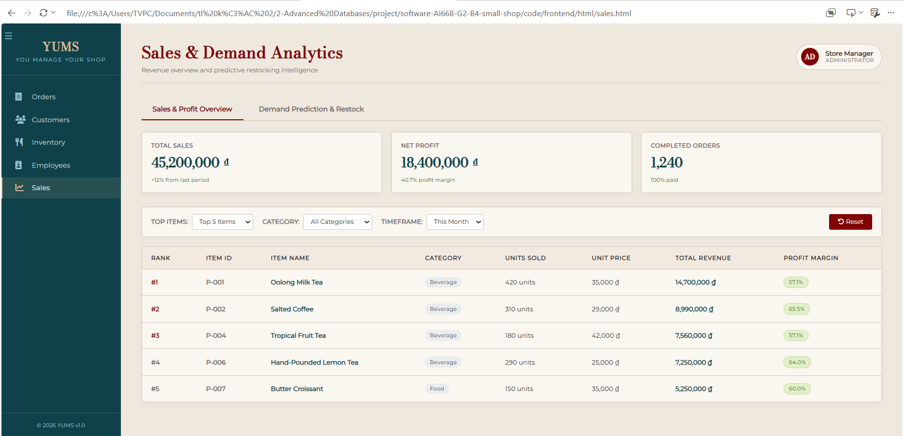
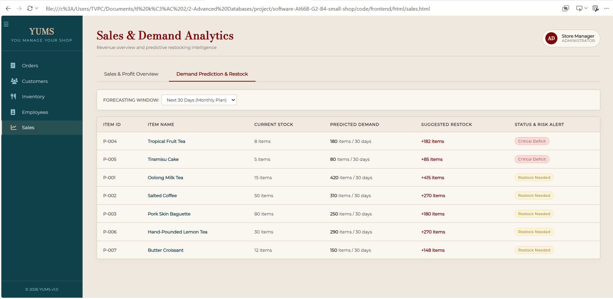
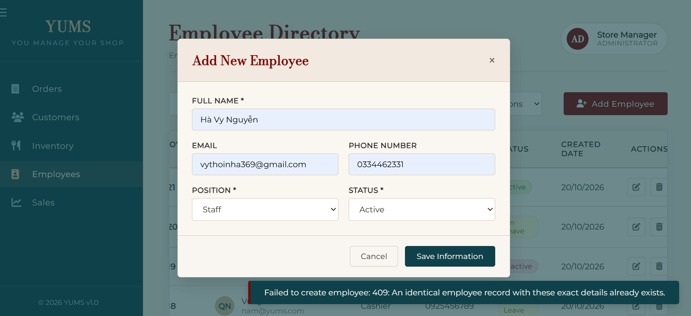
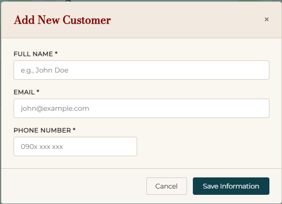

# YUMS — UI Documentation (M3)

## 1. PO Stories and Screen Flow

### 1.1 PO Stories

| User Story | Screen | Route | Status | Related Issue |
|---|---|---|---|---|
| US01 - Create an order | Order Directory (New order tab) | `/order` | partly works - it’s fine by our old logic in linking a to-be-created order to a customer, but not by our new logic of this problem. Will fix this once the code is fixed. | #198 |
| US02 — Confirm delivery status | Order Directory (Check order tab) | `/order/check/{id}/deliver` | partly works - we’ve agreed that an order should have multiple delivery status rather than multiple payment status, but it’s still working by payment status, where Success = successful in payment + delivered | #199 |
| US06 - View all orders | Order Directory (Check order tab) | `/order/check` | works | #203 |
| US11 Sales Analytics & Forecasting | Sales Dashboard | `/sales` | works | #205 |
| US15 Demand forecasting | Sales & Demand Analytics | `/sales` | works | #205 |
| US16 Restock recommendation | Sales & Demand Analytics | `/sales` | works | #206 |
**Status:** Not Started / In Progress / Completed

### 1.2 Screen Flow Diagram

<!-- Add or update the screen-flow diagram here. -->


---
- Sales Flow for US11
```
[Main Navigation Sidebar] 
           │
           ▼ (Click "Sales")
┌────────────────────────────────────────────────────────────────────────┐
│                          /sales (/sales.html)                          │
├────────────────────────────────────────────────────────────────────────┤
│                      Tab Navigation (Switch Tabs)                      │
│                                                                        │
│   ┌──────────────────────────────────┐┌────────────────────────────┐   │
│   │   Tab 1: Sales Overview (Active) ││ Tab 2: Demand Prediction   │   │
│   └──────────────────────────────────┘└────────────────────────────┘   │
└──────────────────────────────────┬─────────────────────────────────────┘
                                   │
         ┌─────────────────────────┴─────────────────────────┐
         ▼                                                   ▼
┌───────────────────────────────┐           ┌───────────────────────────────┐
│ [Tab 1: Sales & Profit Overview] │           │ [Tab 2: Predictive Forecasting]│
├───────────────────────────────┤           ├───────────────────────────────┤
│ 1. Load KPI Summary Cards     │           │ 1. Select Forecasting Window  │
│    - Total Sales              │           │    (7, 14, or 30 Days)        │
│    - Net Profit               │           │                               │
│    - Completed Orders         │           │ 2. System Calculates Metrics  │
│                               │           │    - Daily Sales Speed        │
│ 2. Apply Filters              │           │    - Predicted Demand         │
│    - Top Items (3/5/10/All)   │           │    - Suggested Restock        │
│    - Category (Beverage/...)  │           │                               │
│    - Timeframe (Daily/...)    │           │ 3. Priority Sorting & Risk    │
│    - Reset Filters Button     │           │    - Critical Deficit (Red)   │
│                               │           │    - Restock Needed (Yellow)  │
│ 3. Render Top-Selling Table   │           │    - Sufficient Stock (Green) │
│    - Calculated Profit Margin │           │                               │
│      per item                 │           │ 4. Render Restock Order Table │
└───────────────────────────────┘           └───────────────────────────────┘
```


## 2. UI Wireframes

Document every screen related to the PO user stories.

### 2.1 [Create an Order]

**Related User Story:** US01 — [Create an order]

**Purpose:**  
The user comes here to create a new order by choosing dishes and quantity, sum them up and confirm the customer’s payment.

**Route:**  
`/order`

**API Endpoints:**

| Method | Endpoint | Purpose |
|---|---|---|
| GET | `/api/products` | Fetch products to display on the selection area |
| GET | `/api/customers/search?phone=<number>` | Fetch the customer(s) with the phone number the order creator is trying to search |
| POST | `api/orders` | Create new order |

**Wireframe:**


### 2.2 [Confirm Delivery Status]

**Related User Story:** US02 — [Confirm an order's delivery status]

**Purpose:**  
The user comes here to confirm an already-created order’s delivery status by changing it from Not delivered to Delivered.

**Route:**  
`/order/check/{id}/deliver`

**API Endpoints:**

| Method | Endpoint | Purpose |
|---|---|---|
| POST | `api/orders/{id}` | Fetch the order with that particular id's information |
| PATCH | `/order/check/{id}/deliver` | Change that order's delivery status

**Wireframe:**


### 2.3 [View All Orders]

**Related User Story:** US01 — [View all orders]

**Purpose:**  
The user comes here to view previously created orders and their basic information.

**Route:**  
`/order/check`

**API Endpoints:**

| Method | Endpoint | Purpose |
|---|---|---|
| GET | `api/orders` | Fetch all orders |

**Wireframe:**


---
### 2.4 US11: Sales Analytics & Demand Prediction (4 States)

**Purpose:**  
The user comes here to analyze top-selling products by revenue, view profit margins, and monitor predictive restocking demands for inventory management.

**Route:**  
`/sales`

**Calls:**  
`GET /api/sales/overview`, `GET /api/sales/predictions`
```
+-----------------------------------+-----------------------------------+
| Empty                             | Loading                           |
| No sales or inventory data available| (spinner) Loading analytics...   |
| for the selected timeframe.       |                                   |
| [Reset Filters]                   |                                   |
+-----------------------------------+-----------------------------------+
| Error                             | Data                              |
| Unable to connect to backend server| Total Sales: 45,200,000 ₫        |
| [Try Again]                       | Rank #1: Oolong Tea (420 units)   |
|                                   | Restock Alert: Critical Deficit   |
+-----------------------------------+-----------------------------------+
```

---

### 2.5 US15: Demand Forecasting & Restock Alert (4 States)

The user comes here to analyze historical sales rates, predict inventory demand for the next 7, 14, or 30 days, and identify critical stock deficit risks.

**Route:** `/sales`  
**Calls:** `GET /api/sales/overview`, `GET /api/sales/predictions`
```
+-- Empty ---------------------+  +-- Loading -------------------+
|                              |  |                              |
|   No inventory forecast data |  |          (spinner)           |
|      available to display.   |  |   Calculating demand...      |
|                              |  |    [====================]    |
+------------------------------+  +------------------------------+
+-- Error ---------------------+  +-- Data ----------------------+
|                              |  | Item: Oolong Milk Tea        |
|  Failed to load forecast data|  | Current Stock: 15 items      |
|        [ Try again ]         |  | Forecast (30d): 420 items    |
|                              |  | Alert: Restock Needed (+415) |
+------------------------------+  +------------------------------+
```


---

### 2.6 US16: Automated Restock Recommendation & Risk Sorting (4 States)

The user comes here to view automated restocking recommendations based on current inventory deficits and prioritized risk categories (Critical Deficit, Restock Needed, Sufficient Stock).

**Route:** `/sales`  
**Calls:** `GET /api/sales/predictions`, `POST /api/inventory/restock-orders`
```
+-- Empty ---------------------+  +-- Loading -------------------+
|                              |  |                              |
|  All stock levels are safe!  |  |          (spinner)           |
|  No restock recommendations. |  | Analyzing stock deficits...  |
|                              |  |    [====================]    |
+------------------------------+  +------------------------------+
+-- Error ---------------------+  +-- Data ----------------------+
|                              |  | Item: Tiramisu Cake          |
| Unable to load restock list. |  | Stock: 5 | Demand: 80        |
|        [ Try again ]         |  | Restock: +85 units           |
|                              |  | Alert: [ Critical Deficit ]  |
+------------------------------+  +------------------------------+
```

---

## 3. User-Friendly Error Messages

Document at least four error messages mapped to actual API error codes and business rules.

| # | Related User Story | API Error Code | Business Rule | User-Friendly Message | Suggested Action |
|---|---|---|---|---|---|
| 1 | US01 | 409 | BR1 | This product is insufficient at the moment! | Choose another product that is not ran out |
| 2 | US01 | 409 | BR4 | This product is expired and cannot be sold! | Choose another product that is still edible |
| 3 | US01 | 422 | BR10 | An order must contain at least one product! | Make sure to click at least one dish before clicking "Sum" |
| 4 | US02 | 409 | BR2 | Your already confirmed this order's delivery status! | Only change a Not Delivered order's delivery status. Or "Deliver" button won't appear on already-delivered orders at all |
| 5 | US11 | 400 | BR11 | Invalid forecasting window selected! | Choose a valid window option from 7, 14, or 30 days |
| 6 | US11 | 404 | BR12 | No category records found matching your filter! | Clear or change your category search keywords |
| 7 | US11 | 500 | BR15 | Unable to calculate demand prediction! | Contact system administrator to verify historical sales data |
| 8 | US11 | 403 | BR01 | Access denied to sales analytics page! | Log in with an Administrator or Store Manager account |
| 9 | US15 | 400 | BR11 | Invalid forecasting window selected! | Choose a valid window option from 7, 14, or 30 days |
| 10 | US15 | 404 | BR12 | No category records found matching your filter! | Clear or change your category search keywords |
| 11 | US15 | 500 | BR15 | Unable to calculate demand prediction! | Contact system administrator to verify historical sales data |
| 12 | US15 | 403 | BR01 | Access denied to sales analytics page! | Log in with an Administrator or Store Manager account |
| 13 | US16 | 409 | BR16 | Restock recommendation already pending approval! | Review existing restock orders in Inventory before creating a duplicate |
| 14 | US16 | 422 | BR17 | Restock quantity must be greater than zero! | Ensure the calculated deficit requires at least one unit before placing an order |
| 15 | US16 | 503 | BR18 | Supplier catalog database is currently unreachable! | Wait a few minutes and try again or contact system administration |
| 16 | US16 | 403 | BR01 | Access denied to restock management! | Switch to an authorized Store Manager or Administrator account |
**Notes:**
- Use error codes that actually exist in the API/backend.
- Link each error to the relevant business rule.
- Write messages in language that users can understand.
- Explain what the user can do next.
- Do not invent error codes or business rules.

---

## 4. Changes Since M2

Describe the UI changes made since Milestone 2 and explain why they were needed.

### Change 1 — Business Rules updated

**Before M3:**  
BR2: An order cannot be completed before payment is confirmed

An order with “Before-payment” status must remain incomplete until its payment has been confirmed.

**After M3:**  
BR2: An order cannot be completed before payment is confirmed

An order with "Not Delivered" status must not be considered completed and must not contribute to customer spending, loyalty calculations or sales reports until delivery is confirmed.

**Reason for Change:**  
During the refinement of the business process, the team identified that delivery status is a more accurate indicator of order completion than payment status. This change ensures that sales statistics and customer loyalty data reflect only successfully delivered orders.

**Impact on Users:**  
Employees can track order completion more accurately, while managers receive more reliable sales reports and customer analytics. Customers are rewarded only for orders that have actually been delivered.

**Evidence**


### Change 2 — New Business Rule for Order Creation

**Before M3:**  
The system did not explicitly prevent users from creating an order without adding products.

**After M3:**  
A new business rule, BR10, was introduced:

BR10: An order must contain at least one product.

The system validates order data before creation and displays the message "Order must contain at least one product" when no products are included.

**Reason for Change:**  
Testing and requirements review revealed that allowing empty orders could lead to invalid records and data inconsistencies.

**Impact on Users:**  
Employees receive immediate feedback when attempting to create an invalid order, reducing errors and ensuring higher data quality.

### Change 3 — Order Status Redesign

**Before M3:**  
Orders used payment-oriented statuses including:

* Pending
* Success
* Canceled

**After M3:**  
The order workflow was simplified to focus on fulfillment status:

* Delivered
* Not Delivered

**Reason for Change:**  
The previous statuses focused primarily on payment progress and did not accurately represent whether customers had received their orders. The revised statuses better reflect the actual fulfillment state of an order.

**Impact on Users:**  
Employees can track order fulfillment more easily, and reports can distinguish completed deliveries from unfinished transactions more accurately.

**Evidence**


### Change 4 — Enhanced Error Handling

**Before M3:**  
The system provided limited feedback for server-side and client-side failures, making it difficult for users to understand what went wrong

**After M3:**  
Dedicated error messages were added for 4xx (Bad Request) and 5xx (Server Error) responses to provide clearer system feedback..

**Reason for Change:**  
Feedback from testing indicated that generic error responses reduced usability and made troubleshooting difficult.

**Impact on Users:**  
Users receive more informative error messages, allowing them to identify invalid input or temporary system issues more quickly.

**Evidence:**



### Change 5 — Customer Form Simplification

**Before M3:**  
The customer creation form included fields for Tier and Budget when adding a new customer.

**After M3:**  
The Tier and Budget fields were removed from the customer creation form.

**Reason for Change:**  
Requirements analysis showed that these fields were either derived automatically by the system or not required during customer registration. Their presence increased form complexity without providing immediate value.

**Impact on Users:**  
The customer registration process becomes simpler and faster, reducing unnecessary data entry and minimizing user errors.

**Evidence:**



**Design Document:**  
See [`design.md`](design.md) for the corresponding UI design change.

---

## 5. References

- UI wireframes and screenshots: `docs/images/ui/`
- UI design decisions: `docs/design.md`
- Setup instructions: `docs/SETUP.md`
- Project user stories: TODO: Link to the relevant requirements document
